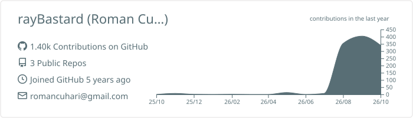
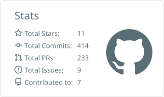
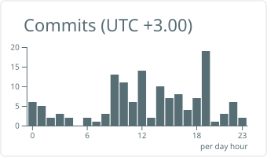

# Hey, I'm Roman Cuhari (aka rayBastard) 👋

**Full-stack developer** from Moldova 🇲🇩 — core contributor at **[CCXT](https://github.com/ccxt/ccxt)**, the cryptocurrency exchange trading library used by thousands of trading bots and fintech products, and the solo builder of **[apneist.pro](https://apneist.pro)**, the social network for freedivers.

> 🏆 **170+ PRs landed in master** · **top contributor** at [ccxt/ccxt](https://github.com/ccxt/ccxt/graphs/contributors) · contributing since 2024
>
> 🌊 **[apneist.pro](https://apneist.pro)** · [@apneistpro](https://github.com/apneistpro) · launched October 2026 · native iOS app in review

## 🔧 What I do at CCXT

CCXT is a single TypeScript codebase transpiled to **JavaScript, Python, PHP, C#, Go, Java and Rust** — every change has to work identically in seven languages. My contributions include:

- 🏗️ **New exchange integrations built from scratch:** [Deepcoin](https://github.com/ccxt/ccxt/blob/master/ts/src/deepcoin.ts), [HashKey](https://github.com/ccxt/ccxt/blob/master/ts/src/hashkey.ts), [Coincatch](https://github.com/ccxt/ccxt/pull/23589), [OX.FUN](https://github.com/ccxt/ccxt/pull/22354), [Polymarket Perps](https://github.com/ccxt/ccxt/pull/30268) (in review)
- ⚡ **WebSocket (ccxt.pro) implementations:** real-time orderbooks, trades, balances and orders for TradeOgre, LBank, XT, WhiteBIT and more
- 🎲 **Prediction-market integrations:** [Opinion](https://github.com/ccxt/ccxt/blob/master/ts/src/prediction/opinion.ts), [sx.bet](https://github.com/ccxt/ccxt/blob/master/ts/src/prediction/sxbet.ts) (WebSocket via Centrifugo)
- 🔍 **Deep exchange audits** — endpoint-by-endpoint verification against live APIs with static-fixture regression tests: WhiteBIT, XT, WOO / WOOFi Pro, WEEX, Toobit, Poloniex, Kraken Futures, Alpaca, Upbit, Tokocrypto, P2B, Phemex, Paradex, Pacifica, Bitget, ModeTrade, Lighter, Nado, Mudrex, LAToken, MEXC
- 🧩 **New unified methods** — e.g. a full history suite for Kraken Futures: `fetchTradingFees`, `fetchLedger`, `fetchFundingHistory`, `fetchPositionsHistory`; liquidations for Hyperliquid: `fetchMyLiquidations`, `watchMyLiquidations`
- 📈 **Advanced trading features:** trailing stops, trigger & TP/SL orders, margin/position management, sandbox & demo-trading modes
- 🛠️ **Unified API maintenance** across dozens of exchanges: Binance, OKX, KuCoin, Kraken, Bitstamp, BitMart, HTX…
- 🍳 **[ccxt-recipes](https://github.com/rayBastard/ccxt-recipes)** — the same five trading tasks solved in all seven CCXT languages, side by side

## 🔀 Latest PRs landed in ccxt/ccxt

<!-- CCXT-PRS:START -->
- [docs(krakenfutures): replace dead doc links in urls.doc and five methods](https://github.com/ccxt/ccxt/pull/30879) · 2026-10-15
- [fix(pacifica): use the funding payout as the funding history amount](https://github.com/ccxt/ccxt/pull/30809) · 2026-10-14
- [fix(latoken): omit the trigger and type params from signed private requests](https://github.com/ccxt/ccxt/pull/30797) · 2026-10-12
- [chore(mexc): correct stale response-shape comments](https://github.com/ccxt/ccxt/pull/30576) · 2026-10-12
- [fix(mexc): place, list and cancel swap trigger orders](https://github.com/ccxt/ccxt/pull/30795) · 2026-10-11
<!-- CCXT-PRS:END -->

↻ auto-updated by GitHub Actions

## 🚧 Currently working on

<!-- CCXT-OPEN-PRS:START -->
- [fix(latoken): align the order capability flags with the implemented methods ](https://github.com/ccxt/ccxt/pull/30885) · opened 2026-10-15
- [fix(mexc): raise NotSupported from the market-type guards](https://github.com/ccxt/ccxt/pull/30884) · opened 2026-10-15
- [fix(modetrade): derive market active flag from the status field](https://github.com/ccxt/ccxt/pull/30878) · opened 2026-10-14
- [fix(okx): handle the plain-text ws pong before the error handler](https://github.com/ccxt/ccxt/pull/30874) · opened 2026-10-14
- [fix(okx): load markets in watchTicker, watchMarkPrice and watchFundingRate](https://github.com/ccxt/ccxt/pull/30872) · opened 2026-10-14
<!-- CCXT-OPEN-PRS:END -->

## 🧰 Languages & tools

## 📊 GitHub stats

<picture>
  <source media="(prefers-color-scheme: dark)" srcset="profile-summary-card-output/github_dark/0-profile-details.svg">
  
</picture>
<picture>
  <source media="(prefers-color-scheme: dark)" srcset="profile-summary-card-output/github_dark/3-stats.svg">
  
</picture>
<picture>
  <source media="(prefers-color-scheme: dark)" srcset="profile-summary-card-output/github_dark/4-productive-time.svg">
  
</picture>

↻ cards are regenerated daily by GitHub Actions — no third-party image services

## 🎯 Beyond code

- 🤿 **Freediving** — captain of the **Moldova national freediving team** 🇲🇩, and the reason apneist.pro exists
- 🐺 **AS Roma** tifoso — *Daje Roma!* ❤️💛
- 🎸🎹 **Music** — guitar & piano
- ⚙️ **Warhammer 40K** — in the grim darkness of the far future, there is only merge conflict resolution

## 📫 Reach me

> 💬 **Got a CCXT question?** Integrating an exchange, debugging a unified method, or something behaves oddly — ping me on [Telegram](https://t.me/raybastard22), happy to help.

